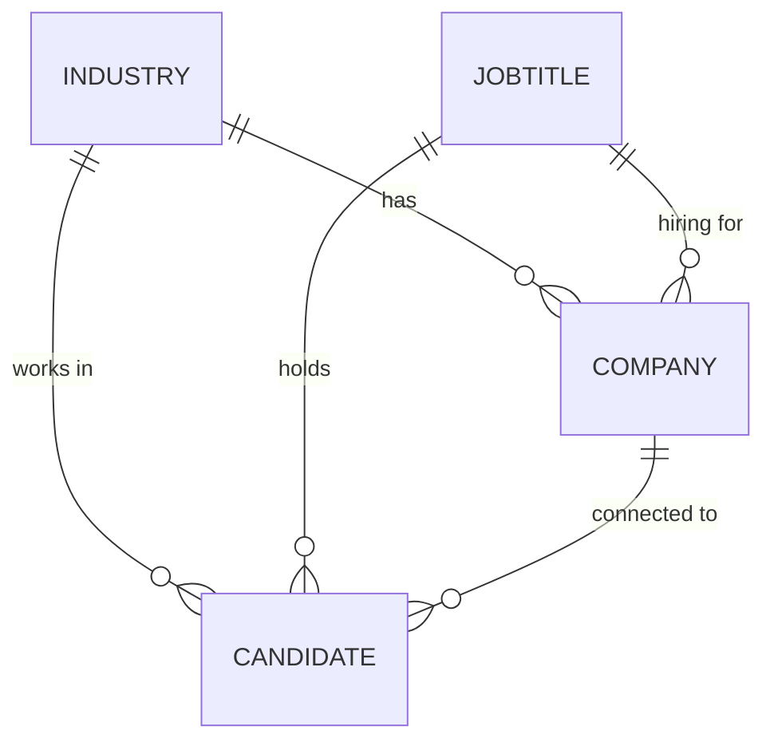

# RecruitCat

A recruiting agency web app for managing **candidates, companies, industries and job titles**, and the relationships between them. It's built with ASP.NET Core Razor Pages and Entity Framework Core on SQL Server, as a course project for IS 7012 at the University of Cincinnati's Lindner College of Business.

## What it does

- **Full create, read, update and delete for four entities:** candidates, companies, industries and job titles, each with list, details, create, edit and delete pages.
- **Related data:** a candidate can be linked to a company, a job title and an industry, and a company lists the candidates connected to it.
- **Validation:** required fields, length limits and number ranges are enforced on both the form and the model. Salaries and revenue show as currency, and dates use date pickers.
- **Recruiting details:**
  - for candidates: target salary, available start date and whether they're currently employed;
  - for companies: salary range, location, headcount, revenue and whether the role is remote friendly.
- **Company website pages:** a home page with services and contact details, and an "Our Team" page.

## Data model



## Tech

ASP.NET Core 8 Razor Pages · C# · Entity Framework Core 9 (code-first migrations) · SQL Server LocalDB · Bootstrap

## Running it

You need the [.NET 8 SDK](https://dotnet.microsoft.com/download) and SQL Server LocalDB, which comes with Visual Studio on Windows.

```bash
cd RecruitCatChaudhnt
dotnet tool install --global dotnet-ef   # once
dotnet ef database update                # creates the database from the migrations
dotnet run
```

Then open the URL it prints, usually https://localhost:5001. The connection string is in `RecruitCatChaudhnt/appsettings.json`. Point it at another SQL Server to run outside Windows.

## Project structure

```
RecruitCatChaudhnt/
  Models/       Candidate, Company, Industry, JobTitle and the EF Core DbContext
  Pages/        Razor Pages: one folder per entity (list, details, create, edit, delete), plus Home and Our Team
  Migrations/   EF Core migrations that create the database schema
  wwwroot/      CSS, JavaScript and images
```
